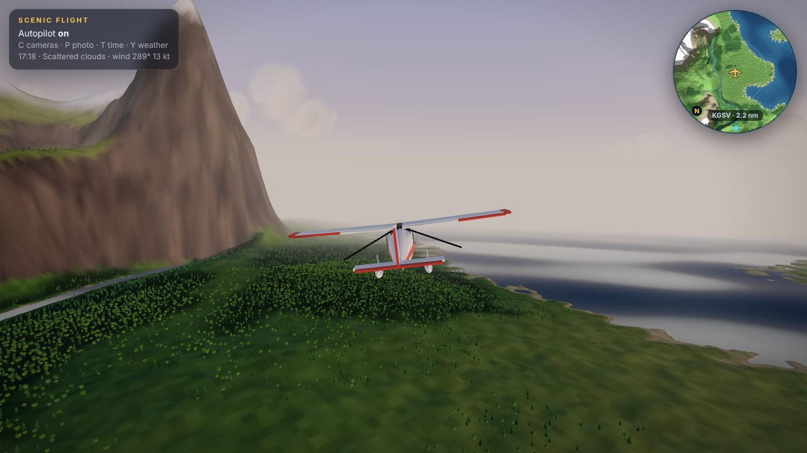
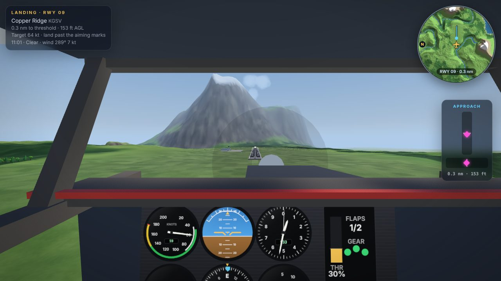
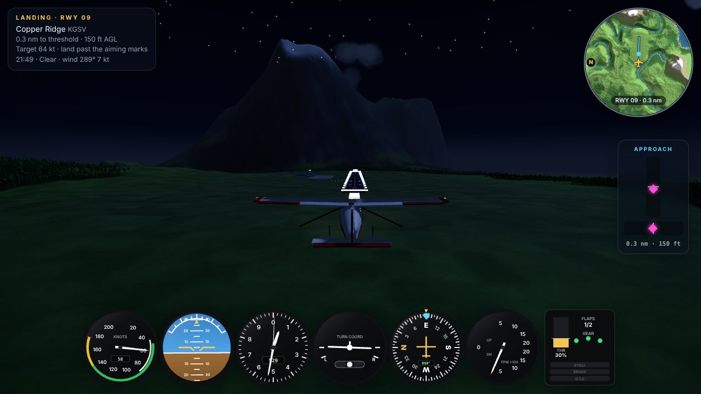
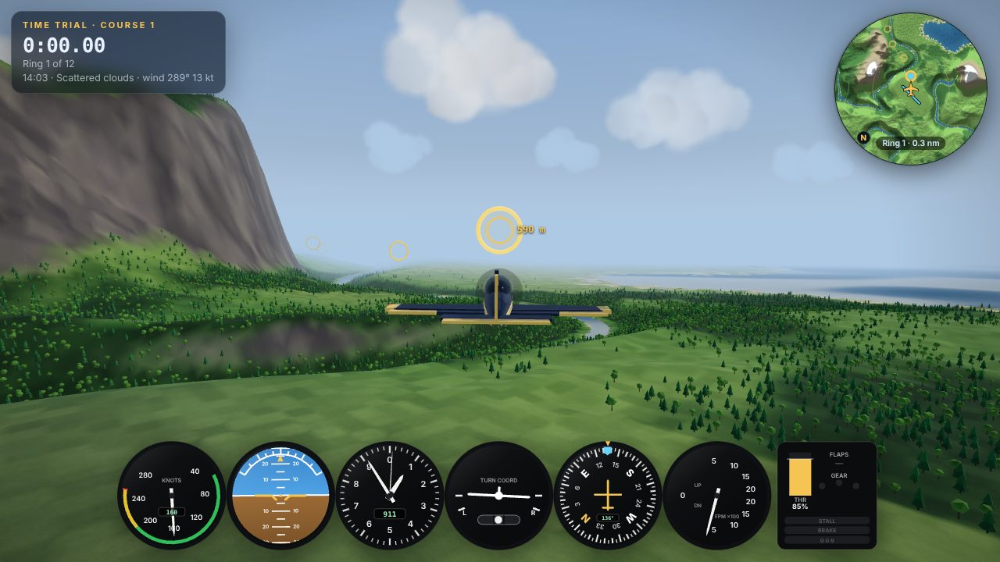
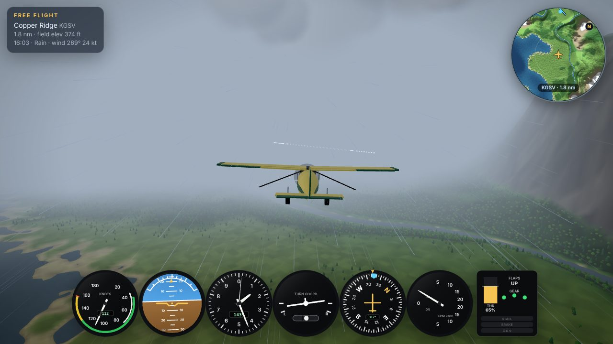

# Flight Deck

Fly a small aircraft over an endless, procedurally generated landscape — in the browser,
with no downloads and no image assets. Built with **Vite** and **Three.js**.



- **Endless world**: mountains, rivers, lakes, forests and snowy peaks, streamed in chunks
  with level of detail. The default world uses a fixed seed; a random or custom seed is one click away.
- **Three aircraft** with genuinely different handling: the forgiving *Skylark T-1* trainer,
  the twitchy *Vortex A-7* aerobatic plane (retractable gear, ~300°/s roll) and the
  *Kodiak STOL* bush plane (huge flaps, ~190 m takeoff roll).
- **Cockpit with working instruments** (airspeed with colour arcs, attitude, altimeter, turn
  coordinator, heading with bug, vertical speed) plus a chase camera and a cinematic fly-by camera.
- **Day/night cycle** with sunsets, moonlight and stars; **weather** (scattered, overcast, rain,
  fog) with wind and turbulence that affect the aircraft.
- **Airports** with marked runways, lights and working PAPI glide-slope lights;
  a **landing challenge** scored out of 100, a **ring time trial**, a calm **scenic mode**
  with an autopilot, and a **photo mode**.
- Keyboard, mouse, **touch** and gamepad controls. **Low / Medium / High** graphics quality.

| | |
|---|---|
|  |  |
|  |  |

## Run it

Requires **Node.js 20.19 or newer** (Node 22 LTS recommended) and a browser with WebGL 2
(current Chrome, Edge, Firefox or Safari).

### Windows (PowerShell or Command Prompt)

```powershell
git clone https://github.com/Integral7/Flight-deck.git
cd Flight-deck
git checkout claude/stoic-johnson-0i522r
npm install
npm run dev
```

Then open <http://localhost:5173>.

### macOS / Linux

Same commands in a terminal.

### Scripts

| Command | What it does |
|---|---|
| `npm run dev` | Development server with hot reload (also reachable from your phone on the LAN) |
| `npm test` | Vitest suite: flight model, terrain, chunks, landing, courses, autopilot, weather, input… |
| `npm run lint` | ESLint |
| `npm run build` | Production build into `dist/` |
| `npm run preview` | Serve the production build on <http://localhost:4173> |
| `node scripts/verify.mjs` | Headless-browser verification matrix (see *How this was built*) |
| `node scripts/terrain-map.mjs 1337` | Render a top-down biome map of a seed to `screenshots/` |
| `node scripts/tune-flight.mjs` | Print each aircraft's flight envelope (stall, top speed, climb, roll rate) |

## Controls

| Key | Action |
|---|---|
| W / S or ↑ / ↓ | Pitch (W = nose down, like pushing a stick; invertible in the menu) |
| A / D or ← / → | Roll |
| Q / E | Rudder |
| Shift / Z | Throttle up / down (1–9 and 0 set 10 %–100 %, \` = idle) |
| B or Space | Wheel brakes (hold) |
| G | Landing gear (Vortex A-7 only) |
| V | Flaps: up / half / full |
| C | Camera: chase → cockpit → fly-by |
| Mouse drag, wheel | Look around, zoom the chase camera |
| M | Large map (wheel zooms) |
| T | Time of day +1 hour |
| Y | Cycle weather (clear → scattered → overcast → rain → fog) |
| P | Photo mode |
| U | Hide / show HUD |
| R | Reset |
| Enter | Retry after a crash or a result |
| Esc | Pause menu |
| H | Help |

Throttle down is **Z**, not Ctrl: Ctrl+W would close the browser tab mid-dive.

**Touch:** left stick pitches and rolls (drag down to climb), the right slider is the throttle,
◀ ▶ under the stick are the rudder, buttons for brakes, flaps, gear, camera, map, photo and pause.
Drag the scenery to look around. Add `?touch=1` to try it with a mouse.
**Gamepad:** left stick flies, triggers are rudder, bumpers throttle, right stick looks around.

## Menu, modes and settings

The start menu picks a **mode**, an **aircraft** and settings (all remembered in the browser):

- **Graphics quality — Low / Medium / High.** Low is for laptops with integrated graphics: no
  shadows or antialiasing, 3 km view distance, fewer and simpler trees, fewer clouds and raindrops,
  capped pixel ratio. High is for gaming GPUs: 6 km view, 2048² shadows, dense forests.
  "Lower resolution automatically" trims render resolution when the frame rate dips.
  Quality can also be switched at any time from the pause menu.
- **World:** the classic world (seed 1337), a random world each flight, or a custom seed.
- Time of day, day/night cycle speed, weather, invert pitch, FPS counter.

**Modes**

- **Free flight** — start near your home airport and explore. The HUD points to the nearest airport.
- **Landing challenge** — start on a 3° final approach to the runway end facing into the wind. The
  approach panel shows glide slope and centreline (fly toward the magenta diamonds) and the PAPI
  lights show two white / two red on the glide path. Scored out of 100: touchdown rate (40),
  centreline (20), touchdown zone (20), wings level (10), stopping on the runway (10), minus 10 per
  bounce. Grades S–D; best score saved per aircraft.
- **Time trial** — twelve rings on a seeded course. The clock starts at the first ring and a
  missed ring costs 5 s. Best times are saved per aircraft and course; *Next course* makes another.
- **Scenic** — no crashes, minimal HUD, an autopilot that wanders over the landscape and routes
  around mountains it cannot out-climb, and automatic cinematic camera cuts. Touch the controls to
  fly yourself; the autopilot takes over again after 6 s hands-off.

**Photo mode** (P) freezes time, gives you an orbit camera (drag / wheel) with sliders for field
of view, exposure and time of day, and saves a PNG.

**URL options** (adding `mode` or `autostart` skips the menu):
`?mode=free|landing|timetrial|scenic`, `?aircraft=trainer|aerobatic|bush`,
`?quality=low|medium|high`, `?seed=1234`, `?time=17.5`, `?weather=clear|cloudy|overcast|rain|fog`,
`?touch=1`, `?adaptive=0`.

## Project layout

```
src/
  main.js, game.js        bootstrap; Game owns the loop, world, aircraft, cameras, HUD, modes
  engine/                 renderer (tone mapping, reversed-Z, dynamic resolution), fixed-step loop,
                          settings + quality presets, seeded PRNG + simplex noise
  terrain/                heightfield (pure), chunk + tree builders (pure), map tiles (pure),
                          Web Worker + pool, chunk streaming/LOD manager, terrain material, vegetation
  aircraft/               aircraft types, flight model (pure), autopilot (pure), procedural models
  world/                  day/night (pure), sky, environment/lighting, weather (pure), clouds, rain,
                          water, airports, rings, crash effects
  camera/                 chase / cockpit / fly-by / photo-orbit rig
  cockpit/                3D cockpit interior with a live instrument-panel texture
  hud/                    canvas instruments, HUD, warnings (pure), minimap + large map, menu,
                          overlays, target marker
  input/                  keyboard, mouse, gamepad, touch; bindings
  modes/                  free flight, landing, time trial, scenic, photo; runway + course maths (pure)
tests/                    Vitest (Node) — 149 tests
scripts/                  smoke test, verification matrix, terrain map, flight tuning, README shots
```

---

## How this was built

This project was built by Claude (an AI coding agent) in one long session, working with the
user in stages. The user asked for a plan first; the plan was approved with four additions —
pause for review after milestone 5 (flyable) and after milestone 9 (airports and landing), keep
a `PROGRESS.md` updated after every milestone so work can resume in a new session, push often,
and add a Low/Medium/High quality setting. Thirteen milestones followed, each committed and pushed.

### Process

1. **Plan and constraints.** Vanilla ES modules (no framework), no external assets (everything —
   aircraft, trees, buildings, textures, sky, clouds — is generated in code), and a strict split
   between *pure* modules (terrain, flight model, weather, scoring…) that run in Node for tests and
   *rendering* modules that use Three.js.
2. **Build in vertical slices.** Each milestone ended with: unit tests green, lint clean, a run in
   headless Chromium (`scripts/smoke.mjs`) with console errors collected and screenshots inspected,
   then a commit, a `PROGRESS.md` update and a push.
3. **Look at the result.** Many fixes came from looking at screenshots rather than from tests:
   washed-out colours, a cockpit glareshield that hid the runway on final, overlapping gauge labels,
   an empty modal that showed because CSS `display` overrode `[hidden]`, menu stat bars stacked by a
   stray CSS rule.

### Terrain

`terrain/heightfield.js` is a pure function of `(x, z, seed)` used by the mesh builder, collision,
the minimap, airport placement and the tests, so they always agree. Layers: a domain-warped
low-frequency *continental* field (sea vs land), *mountain ranges* from ridged multifractal noise
masked into belts (with a "soft abs" so ridges are steep but never knife-edged), rolling hills and
small detail. **Rivers** follow the zero contour of a separate noise field; dividing the noise value
by its gradient turns it into an approximate distance in metres, which carves a channel below sea
level and a valley whose width grows with the height it cuts through (so banks never become
cliffs). Rivers fade out in high ground, which reads naturally as their source. **Airports** are
placed at most one per 7 km cell: candidate sites are tested for flatness, dryness and distance
from rivers, then a pad is flattened and blended into the surroundings inside the same function.

The first parameter set produced cliffs of 12:1; tests on slope distributions (and a step-halving
continuity test that proves there are no discontinuities) drove the tuning.

### Streaming and level of detail

The world is cut into 512 m chunks. Each chunk in a circle around the camera gets one of four LODs
(64/32/16/8 segments) chosen by 3D distance — altitude counts, so high flight is cheap — with
hysteresis so chunks don't flicker between levels. Meshes are built in a pool of **Web Workers**
and returned as transferable typed arrays; the old mesh stays until its replacement arrives, so
there are never holes. **Skirts** hang below every chunk edge to hide cracks between LODs; a test
measures the worst seam gap between neighbouring LODs and checks the skirts cover it. Trees are
instanced per chunk in two tiers (detailed near the camera, sparse low-poly beyond), so forests
fade out instead of ending at a line. A tile-cached map renderer reuses the same workers to
rasterise the minimap.

### Flight model

`aircraft/flightModel.js` is an *arcade model with physics flavour*, stepped at a fixed 120 Hz with
render interpolation. Forces are real equations — lift with a stall break and post-stall drop,
induced and parasitic drag, flaps, gear drag, ground effect, thrust that fades with airspeed,
gravity — but rotation is rate-commanded: stick inputs ask for body rates, weathervane stability
pulls the nose toward the relative wind, and the aircraft auto-trims toward 1 g so hands-off flight
is calm. Ground handling covers rolling friction, brakes, nose-wheel steering and static friction
when parked. Touchdowns are classified (hard impact, ditching, belly landing, wingtip strike, too
steep), and probes at the nose and wingtips catch flying into hillsides. Handling differences come
only from the numbers in `types.js`; `scripts/tune-flight.mjs` flies each aircraft through standard
manoeuvres with a small autopilot to print its envelope.

### Lighting, sky and weather

A pure day/night model gives the sun's position and keyframed sky/light/fog colours by sun
elevation. A gradient sky dome with sun and moon, a star field, sun/moon directional light with
shadows following the aircraft, hemisphere ambient, fog matched to the horizon colour and an
environment map rendered from the sky (for water reflections) are all driven from it. Shadows fade
through `shadow.intensity` rather than toggling `castShadow`, which would force shader recompiles
mid-flight. A colour bug was found by eye: the terrain palette was authored in sRGB but used as
linear vertex colours, which washed everything out.

Weather presets blend smoothly; they drive cloud cover (instanced, camera-facing, back-to-front
sorted puffs generated per world cell), GPU rain streaks animated entirely in the vertex shader,
fog distance, overcast sky and light, and the flight model's wind and turbulence. Flying into an
overcast layer collapses visibility.

### HUD, cockpit and modes

The gauges are drawn with Canvas 2D; the same code feeds the chase-view HUD and a `CanvasTexture`
on the 3D instrument panel. Needle mappings, warnings (stall, pull up, sink rate, gear, overspeed,
bank angle), runway geometry, ILS-style guidance, PAPI logic, landing scores and ring-gate detection
are pure functions with tests. Game modes share one small interface (`start / restart / update /
onEvent / info / target`), so free flight, landing, time trial and scenic plug into the same loop.

### Testing

149 Vitest tests run in Node in a few seconds. Beyond unit checks, several tests **fly**: an
autopilot flies the glide path through the real flight model and must earn a passing landing score;
another threads a whole ring course in the trainer; the scenic autopilot must survive three minutes
over the real procedural terrain in every aircraft. Others cover determinism, behaviour under random
inputs with turbulence (state stays finite), takeoff within the runway length, LOD seam coverage
and mesh winding.

`scripts/verify.mjs` then runs the real app in headless Chromium across 16 cases — menu, every mode,
all three quality levels, every aircraft, cockpit view, rain at night, fog, photo mode, pause, map,
phone-sized touch layout, live quality switching (which recreates the WebGL renderer) and seed
switching — failing on any console error, and finishes with a **streaming leak test** that
teleports the aircraft ten times and checks GPU geometry and chunk counts stay flat.

### Performance work

The test browser renders in software (SwiftShader), so absolute FPS there is meaningless; instead
the work tracked CPU time per subsystem, draw calls and triangle counts, and fixed what those showed:

- **Worker throughput was frame-rate bound** — each worker got one job per rendered frame. Workers
  now keep a small queue, and finished results are attached by priority (missing terrain first,
  then near trees, refinements, far trees) under a per-frame time budget instead of a fixed count.
- A **loading gate** holds the simulation until the terrain around the aircraft has streamed in,
  attaching more per frame while it waits, so you never start over a hole.
- The **chunk ring scan** only reruns when the camera has moved ~24 m or a quarter second passed.
- **Trees** dropped ~40 % of their triangles (open-ended cones and trunks, one crown for
  broadleaves), and the far tier uses one draw call per chunk.
- Everything in the simulation hot path is allocation-free; shadows and lights never toggle in a
  way that recompiles shaders; adaptive resolution trims the pixel ratio when frame time climbs.

Measured on the medium preset after loading: about 1–2 ms CPU for terrain streaming and
0.2 ms each for sky, clouds and weather. The scene is roughly 115k triangles and 120 draw calls on
Low, and 300k triangles and 250 draw calls on Medium.

### Known limitations

- Audio is not implemented.
- Trees have no collision; buildings and other aircraft are not simulated.
- The world uses 32-bit vertex positions relative to each chunk, so it stays precise for thousands
  of kilometres, but the shaders' world-space effects (detail noise, water waves) slowly lose
  precision very far from the origin.
